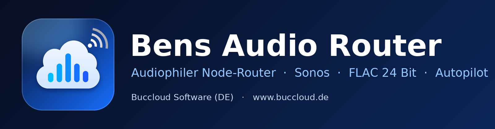
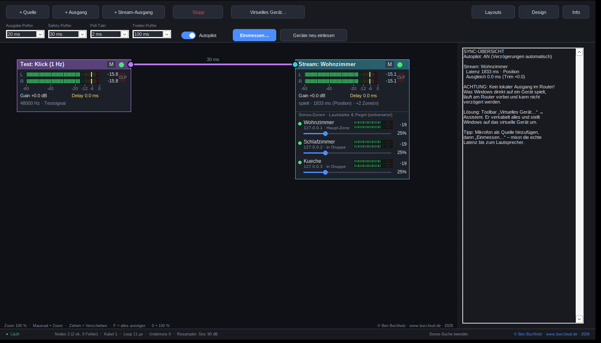

<p align="center"></p>

# Bens Audio Router

   

**Audiophiler Node-Router für Windows – Mitschnitt, lokale Ausgänge und Sonos-Streaming mit automatischem Latenz-Ausgleich.**

Ein Programm von **Buccloud Software (DE)** · © Ben Buchholz · [www.buccloud.de](https://www.buccloud.de) · 2026 · Open Source (MIT)

---

## Was ist das?

Bens Audio Router verbindet Audioquellen und Ausgänge in einem grafischen Dashboard per Drag & Drop. Du ziehst Kabel von
einer Quelle zu mehreren Ausgängen – zum Beispiel vom PC zum lokalen Studio **und** zu einer ganzen **Sonos-Gruppe** – und der
**Autopilot** gleicht die unterschiedlichen Laufzeiten automatisch aus, damit überall zeitgleich gespielt wird.



## Highlights

| | |
|---|---|
| **Node-Dashboard** | Endlos, zoombar, Drag & Drop, Mischen von Quellen, VU-Meter (Stereo, Peak-Hold, Clip) |
| **Audiophile Signalkette** | 32-Bit-Float, Kaiser-Sinc-Resampler (~90 dB Sperrdämpfung), TPDF-Dither nur am Ende, Drift-Regelung im ppm-Bereich |
| **Sonos-Streaming** | UPnP + **FLAC 24 Bit (verlustfrei)** oder WAV 16 Bit, Auto-Fallback, Puffer einstellbar |
| **Sonos-Gruppen** | Koordinator + weitere Zonen (Sonos synchronisiert selbst), **Lautstärkeregler pro Zone** im Dashboard |
| **Autopilot & Einmessen** | Latenz wird gemessen (Mikrofon-Messsweep, Sonos-Position) und automatisch ausgeglichen; Feinkorrektur manuell |
| **Virtuelles Gerät** | Assistent für VB-Audio HIFI-CABLE / VB-CABLE: verkabelt alles, schaltet Windows um, stellt beim Beenden zurück |
| **Layouts** | Konfigurationen als `.bar`-Dateien speichern und laden („Party“, „Alltag“ …) |
| **AirPlay-Empfänger** | iPhone/iPad/Mac spielen nativ per AirPlay direkt in den Router (mit Apple-Geräten getestet; AirPlay 1/RAOP, ALAC 16 Bit/44,1 kHz), Name und Latenz einstellbar |
| **Aufnahme-Box** | Zeichnet das gemischte Signal als **WAV** (16/24 Bit, 32 Bit Float) oder **FLAC** (16/24 Bit, verlustfrei) auf, 44,1–96 kHz. Per Drag & Drop aus der Toolbar aufs Feld ziehen, Quellen verbinden, **● REC**. Immer **genau eine Datei** pro Aufnahme (WAV ab 4 GB automatisch RF64), eigener Schreib-Thread, absturzsicherer Header |
| **Summen-Modul** | Für Mono-Eingänge: zwei Mono-Quellen werden als **Links/Rechts** zugeordnet (je Kabel: Kanal der Quelle → Links, Rechts, Mitte oder Stereo). Beim Mischen aufgelöst: **keine zusätzliche Latenz**, der Autopilot rechnet wie mit direkten Kabeln |
| **Modernes UI** | Natives Dark-Mode (auch Titelleiste und Menüs), Auto/Dunkel/Hell |

## Download

Fertige Programme findest du unter **[Releases](../../releases)** (`BensAudioRouter-win64.zip`: EXE, Anleitung, Lizenz). Die EXE ist **nicht code-signiert**; Windows SmartScreen kann deshalb beim ersten Start warnen („Weitere Informationen → Trotzdem ausführen“). Du kannst sie jederzeit selbst aus dem Quelltext bauen (siehe unten).

## Schnellstart

1. **Virtuellen Treiber installieren** (einmalig): [VB-Audio HIFI-CABLE](https://vb-audio.com/Cable/) bzw. VB-CABLE, als Administrator, danach neu starten.
2. `BensAudioRouter.exe` starten (keine Installation nötig).
3. Toolbar → **Virtuelles Gerät… → Assistent**. Er legt Quelle, lokalen Ausgang und Kabel an und stellt Windows um.
4. **+ Stream-Ausgang** → Sonos-Zone wählen → im Inspector **weitere Zonen** hinzufügen.
5. Optional: **+ Quelle → AirPlay-Empfänger**, dann am iPhone im AirPlay-Menü „Bens Audio Router“ wählen.
6. **Start** drücken. Der **Autopilot** verzögert das lokale Studio passend zum Sonos.
7. Optional: Mikrofon als Quelle hinzufügen und **Einmessen…** für die exakte Latenz.

Die vollständige Bedienung steht in der **[Anleitung](docs/Anleitung.md)** (auch als `Anleitung.html`).

## Systemvoraussetzungen

- Windows 10 (1903+) oder Windows 11, 64 Bit
- Für lokales Routing mit eigenem Gerät: virtueller Audiotreiber (z. B. VB-Audio HIFI-CABLE)
- Für Sonos: Sonos S2 oder S1 im selben Netzwerk (UPnP); Windows-Firewall: privates Netz freigeben

## Aus dem Quelltext bauen

Cross-Compile unter Linux mit MinGW-w64 (oder unter Windows mit MSYS2):

```bash
sudo apt install g++-mingw-w64-x86-64
cd src && ./build.sh        # erzeugt BensAudioRouter.exe
```

Aufbau: `BensAudioRouter.cpp` (App), `core.h` (DSP), `flac.h` (FLAC-Encoder), `calib.h` (Einmessung), `stream.h` (Sonos/UPnP/HTTP), `airplay.h` + `ap_crypto.h` (AirPlay-Empfänger), `alac.c` (ALAC-Decoder), `wavrec.h` (WAV/FLAC-Rekorder der Aufnahme-Box), `route.h` (Kanal-Matrix des Summen-Moduls),
`ui.h` (Theme und Controls), `tests/` (Kern-Tests), `tools/mock_sonos.py` (Sonos-Simulator) und `tools/raop_test_sender.py` (AirPlay-Testsender).

## Status und Roadmap

- **AirPlay-Empfänger (AirPlay 1 / RAOP)** ist mit Apple-Geräten getestet und arbeitet dort nativ (der Router erscheint direkt in der AirPlay-Auswahl). Zusätzlich mit einem eigenen Testsender geprüft (Challenge, Verschlüsselung, ALAC, Paketverlust mit Resend, mDNS). Rückmeldungen zu weiteren Geräten und iOS-/macOS-Versionen sind willkommen.
- **AirPlay 2** (Empfänger und Sender) ist **nicht** enthalten: HomeKit-Pairing, ChaCha20, PTP, AAC und FairPlay sind sehr umfangreich, die Referenzimplementierung unterstützt Windows nicht, und ohne reale Gegengeräte wäre das Ergebnis nicht überprüfbar.
- Geplant: AirPlay-1-Sender (Router → AirPlay-Lautsprecher); AirPlay 2 erst mit einem Zielgerät zum Testen.
- Sonos Connect (Gen 2, 2015) unterstützt kein AirPlay (Herstellerangabe); AirPlay-fähige Sonos-Geräte lassen sich per UPnP-Gruppe einbinden.

## Mitmachen

Fehler melden, Ideen einbringen, testen – siehe [CONTRIBUTING.md](CONTRIBUTING.md). Besonders hilfreich sind Tests mit echten Apple- und Sonos-Geräten. Sicherheitsrelevantes bitte laut [SECURITY.md](SECURITY.md) melden.

## Lizenz und Hinweise

MIT-Lizenz, siehe [LICENSE](LICENSE). Sonos, AirPlay, Apple, Windows und VB-Audio sind Marken ihrer jeweiligen Inhaber; dieses Projekt steht in keiner Verbindung zu ihnen.

**© Ben Buchholz · [www.buccloud.de](https://www.buccloud.de) · 2026 · Software Publisher: Buccloud Software (DE)**
