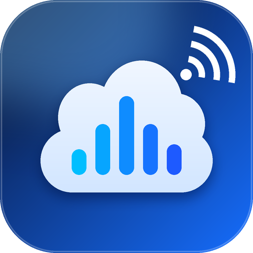
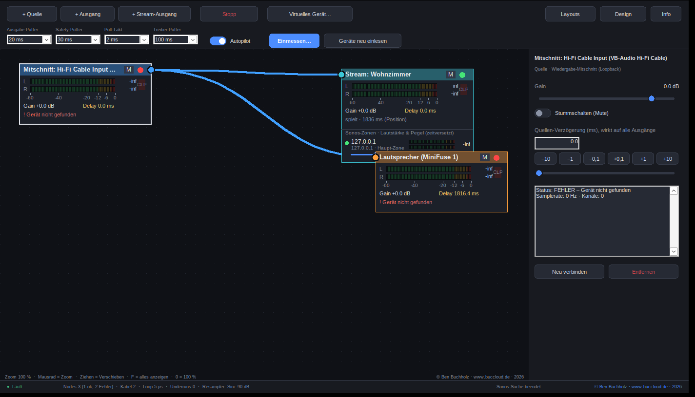
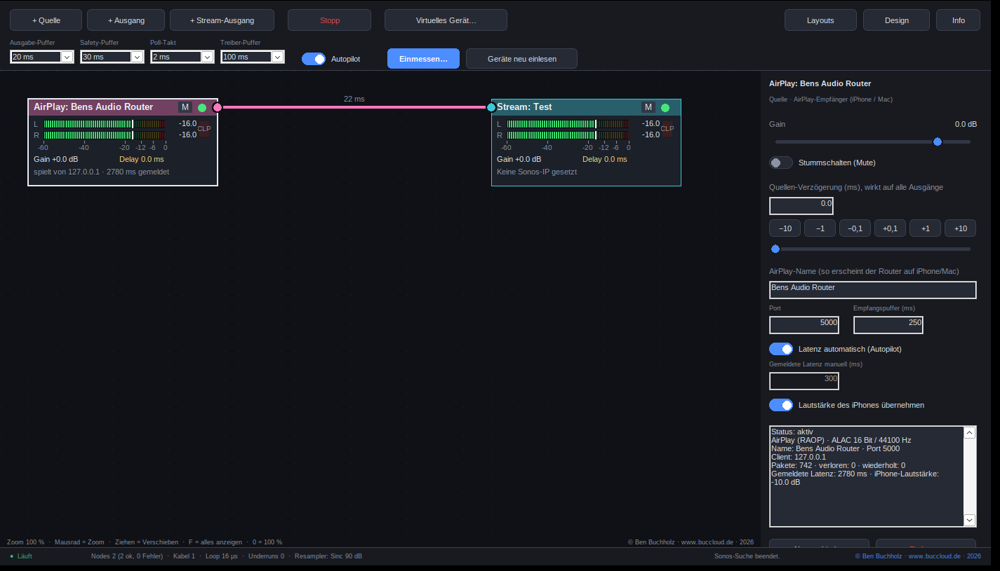

# Bens Audio Router – Anleitung

**Version 4.1 · Buccloud Software (DE) · © Ben Buchholz · [www.buccloud.de](https://www.buccloud.de) · 2026**

Diese Anleitung führt dich von der Installation bis zum fertig synchronisierten Mehrraum-Setup. Wenn du es eilig hast, lies nur Kapitel 1 und 2.

## Inhalt

1. [Das Prinzip in zwei Minuten](#1-das-prinzip-in-zwei-minuten)
2. [Schnellstart in sechs Schritten](#2-schnellstart-in-sechs-schritten)
3. [Das Dashboard](#3-das-dashboard)
4. [Quellen und Ausgänge](#4-quellen-und-ausgänge)
5. [Latenz, Autopilot und Einmessen](#5-latenz-autopilot-und-einmessen)
6. [Sonos-Streaming](#6-sonos-streaming)
7. [Sonos-Gruppen und Lautstärke pro Zone](#7-sonos-gruppen-und-lautstärke-pro-zone)
8. [Virtuelles Gerät – der Assistent](#8-virtuelles-gerät--der-assistent)
9. [AirPlay-Empfänger (iPhone / Mac → Router)](#9-airplay-empfänger-iphone--mac--router)
10. [Layouts, Design und Dateien](#10-layouts-design-und-dateien)
11. [Tastatur und Maus](#11-tastatur-und-maus)
12. [Fehlersuche](#12-fehlersuche)
13. [Technische Hintergründe](#13-technische-hintergründe)
14. [Grenzen, AirPlay 2 und Roadmap](#14-grenzen-airplay-2-und-roadmap)
15. [Rechtliches](#15-rechtliches)

---

## 1. Das Prinzip in zwei Minuten

Windows spielt Musik auf **ein** Gerät. Möchtest du dieselbe Musik zusätzlich in einem anderen Raum hören (z. B. über Sonos), 
läuft das Signal dort immer **später** an – Streaming puffert mehrere Sekunden. Das Ergebnis: Echo und Versatz.

Bens Audio Router löst das so:

1. Dein Player spielt auf ein **virtuelles Gerät**. Der Router erfasst das Signal als **Quelle**.
2. Der Router verteilt es an **alle Ausgänge**: lokale Lautsprecher/DAC (über WASAPI) und Sonos (über einen Stream).
3. Er **misst oder schätzt**, wie lange jeder Ausgang braucht, und **verzögert die schnelleren** so, dass alles gleichzeitig ankommt.

> **Wichtig:** Nur Audio, das *durch* den Router läuft, kann verzögert werden. Was Windows direkt auf ein Gerät spielt, läuft am Router vorbei.
> Deshalb gibt es den Assistenten für das virtuelle Gerät (Kapitel 8).

Preis der Synchronität: Das lokale Gerät hört alles um die Sonos-Latenz später (mehrere Sekunden). Play/Pause und Titelwechsel kommen verzögert an;
für Video ist das ungeeignet. Die Lautstärke regelst du am Verstärker oder im Router, nicht im Player.

## 2. Schnellstart in sechs Schritten

1. **Treiber installieren (einmalig).** Lade [VB-Audio HIFI-CABLE](https://vb-audio.com/Cable/) (bit-perfekt, bis 24 Bit/384 kHz) oder VB-CABLE, installiere als Administrator und starte neu.
   Stelle in den Windows-Sound-Einstellungen für „Input“ und „Output“ des Kabels dieselbe Samplerate ein (z. B. 48000 Hz).
2. **Router starten.** `BensAudioRouter.exe` braucht keine Installation. Beim ersten Start fragt die Windows-Firewall: **Privates Netzwerk erlauben**.
3. **Assistent.** Toolbar → **Virtuelles Gerät… → Assistent**. Er legt die Quelle (Mitschnitt des virtuellen Geräts) und den lokalen Ausgang an,
   verbindet alles und stellt Windows auf das virtuelle Gerät um (das bisherige Standardgerät wird beim Beenden wiederhergestellt).
4. **Sonos hinzufügen.** **+ Stream-Ausgang** → deine Sonos-Zone aus der Liste. Im Inspector (rechts) kannst du weitere Zonen zur Gruppe hinzufügen.
5. **Start** drücken und Musik abspielen. Im Sonos-Node steht „spielt · … ms“. Der **Autopilot** (Schalter in der Toolbar) verzögert das lokale Gerät automatisch.
6. **Optional: exakt einmessen.** Ein Mikrofon als Quelle hinzufügen (+ Quelle → Eingang) und **Einmessen…** drücken.

## 3. Das Dashboard

Das Dashboard ist eine **unendliche Arbeitsfläche**:

- **Zoomen:** Mausrad (auf den Mauszeiger). Bereich 15 % bis 400 %. Taste **0** = 100 %, Taste **F** = alles anzeigen.
- **Verschieben:** auf leerer Fläche mit der linken Maustaste ziehen, oder mittlere/rechte Maustaste ziehen.
- **Kabel ziehen:** vom Kreis (Port) eines Nodes zum Kreis eines anderen Nodes. Quellen haben den Port rechts, Ausgänge links.
- **Kabel trennen:** Rechtsklick auf das Kabel, oder Kabel anklicken und **Entf**.
- **Nodes verschieben:** an der Kopfzeile ziehen. **Nodes entfernen:** Rechtsklick → *Node entfernen* oder **Entf**.
- **Beschriftung am Kabel:** zeigt den aktuellen Lag zwischen Quelle und Ausgang in ms.

### Der Node

Jeder Node zeigt:

- **Kopfzeile:** Name, **M** (Mute), Statuspunkt (grün aktiv, rot Fehler, gelb öffnet, grau gestoppt).
- **VU-Meter L/R:** Peak-Pegel von −60 bis 0 dBFS mit Peak-Hold. **CLP** leuchtet bei Übersteuerung (Klick setzt zurück).
- **Gain und Delay:** aktuelle Werte.
- **Statuszeile:** Samplerate, Gesamtlatenz und deren Quelle (Einmessung, Position, manuell, Schätzung).

### Der Inspector (rechts)

Klickst du einen Node an, erscheinen seine Einstellungen. Ohne Auswahl zeigt der Inspector die **Sync-Übersicht** (Latenz und Ausgleich aller Ausgänge)
und Hinweise, falls etwas im Aufbau fehlt.

## 4. Quellen und Ausgänge

**+ Quelle**

- **Wiedergabe-Mitschnitt (Loopback):** erfasst, was Windows auf ein Wiedergabegerät spielt (z. B. das virtuelle Gerät).
- **Eingang:** Mikrofon oder Line-In. Ein Eingang dient auch als Messmikrofon für die Einmessung.
- **Testgenerator:** Klick (1 Hz), Sinus 1 kHz, Rosa Rauschen – ideal zum Abgleichen per Gehör.

**+ Ausgang**

- **WASAPI-Ausgang:** ein Windows-Wiedergabegerät (Lautsprecher, DAC, MiniFuse …).

**+ Stream-Ausgang**

- **Sonos-Stream:** schickt das Signal als Stream an eine Sonos-Zone (Kapitel 6).

Mehrere Quellen können in einen Ausgang **gemischt** werden, eine Quelle kann auf mehrere Ausgänge gehen.
Ein Loopback-Mitschnitt kann nicht auf dasselbe Gerät zurückgeleitet werden (Rückkopplung wird abgelehnt).

### Pegel und Verzögerung je Node

- **Gain:** −60 bis +12 dB. **Mute:** stummschalten.
- **Quellen-Verzögerung:** verzögert die Quelle für *alle* ihre Ausgänge (0 bis 10 000 ms).
- **Ausgangs-Verzögerung:** nur für diesen Ausgang. Unter **Autopilot** wird sie automatisch berechnet und ausgeblendet.
- **Feinkorrektur:** zusätzlicher Ausgleich in 0,1-ms-Schritten (−200 bis +200 ms), immer verfügbar.

## 5. Latenz, Autopilot und Einmessen

Damit alle Ausgänge **zeitgleich** klingen, muss der Router wissen, wie lange jeder Weg braucht.
Er nutzt dafür diese Quellen, in dieser Reihenfolge:

| Rang | Quelle der Latenz | Genauigkeit | Wann |
|---|---|---|---|
| 1 | **Einmessung (Mikrofon)** | ≈ ±1 ms | nach „Einmessen…“ |
| 2 | **Sonos-Position** | ≈ ±10–20 ms | wenn der Sonos laufende Positionen meldet |
| 3 | **Manuell** | – | Feld „Nachgelagerte Latenz“ (nur wenn Autopilot aus) |
| 4 | **Schätzung** | grob | Rückfall (ca. 2,5 s für Sonos) |

### Autopilot

Der Schalter **Autopilot** in der Toolbar berechnet laufend für jeden Ausgang den Ausgleich:
*Ausgleich = langsamster Ausgang − Latenz dieses Ausgangs.* Die manuellen Delay-Felder sind dann ausgeblendet; die **Feinkorrektur** bleibt.

### Einmessen (mit Mikrofon)

1. **+ Quelle → Eingang:** das Messmikrofon anlegen (z. B. ein Mikrofon an der MiniFuse).
2. **Start** drücken, damit alle Geräte laufen. Der Sonos muss **spielen**.
3. **Einmessen…** drücken und ruhig bleiben. Der Router spielt nacheinander einen kurzen Messsweep (ca. −14 dBFS) über **jeden Ausgang** und
   misst per Kreuzkorrelation, wann er am Mikrofon ankommt. Pro Ausgang dauert das wenige Sekunden (Stream: ca. 12 s).
4. Das Ergebnis wird im Layout gespeichert. Danach läuft alles ohne Mikrofon weiter.

**Hinweise:** Das Mikrofon muss den jeweiligen Lautsprecher hören. Bei getrennten Räumen trägst du es in den Raum oder nutzt ein langes Kabel.
Absolutes Mikrofon-Timing kürzt sich bei Vergleichen heraus; Schallweg-Unterschiede kosten etwa 3 ms pro Meter.
Ändern sich Ausgabe-Puffer, Format oder Vorlauf, wird die Einmessung für diesen Ausgang ungültig – dann erneut einmessen.

## 6. Sonos-Streaming

Der Router startet einen kleinen **HTTP-Server** und sagt dem Sonos per **UPnP**: „Spiel diese Adresse“. Dein PC und der Sonos müssen im selben Netz sein.

**Einstellungen im Inspector (Stream-Node):**

| Einstellung | Bedeutung |
|---|---|
| **Sonos-Zone / IP** | Zone aus der Suche wählen („Suchen“) oder IP eintragen |
| **Stream-Port** | Port des Servers (Standard 8100, je Stream-Node verschieden) |
| **URI-Schema** | `http://` (Standard, empfohlen) oder `x-rincon-mp3radio://` |
| **Samplerate** | 44 100 Hz (nativ für Sonos) oder 48 000 Hz |
| **Audioformat** | **FLAC 24 Bit** (verlustfrei, empfohlen) oder **WAV 16 Bit** (maximal kompatibel) |
| **Puffer-Reserve (Vorlauf)** | 200 bis 8000 ms. Größer = stabiler, aber mehr Latenz |
| **TPDF-Dither** | Rauschformung bei der Bit-Reduktion (empfohlen) |
| **Sonos-Positionsabfrage** | misst die Latenz und führt sie bei Drift nach |

**Automatik:**

- Lehnt der Sonos FLAC ab (UPnP-Fehler), schaltet der Router nach zwei Versuchen **automatisch auf WAV 16 Bit** um.
- Stoppt der Sonos (z. B. durch die Sonos-App), startet der Router die Wiedergabe **automatisch neu**.
- Netzwerkfehler führen **nicht** zur Formatumstellung, nur zum erneuten Versuch.

**Formate:** Sonos akzeptiert WAV nur mit 16 Bit; 24 Bit geht per FLAC (Sonos S2, bis 48 kHz). Die interne Verarbeitung läuft in 32-Bit-Float.

## 7. Sonos-Gruppen und Lautstärke pro Zone

Mehrere Sonos-Zonen laufen nur dann **taktgenau** zusammen, wenn **Sonos sie selbst gruppiert**. Deshalb schickt der Router **einen** Stream an einen
**Koordinator** (die Haupt-Zone des Stream-Nodes) und holt weitere Zonen per UPnP in dessen Gruppe.

**So geht’s:** Stream-Node anklicken → Abschnitt **„Sonos-Gruppe“** → Zone aus der Liste wählen → **+ Zone**. „Gruppe leeren“ löst alle wieder heraus.

Im **Dashboard** zeigt der Stream-Node jede Zone als eigene Zeile:

- **Statuspunkt:** grün „in Gruppe“, rot „nicht beigetreten“, gelb „prüfe …“.
- **VU-Meter:** das Stream-Signal **zeitversetzt um die Latenz** – also das, was dort jetzt hörbar sein sollte. (Sonos liefert keine Pegel je Zone.)
- **Lautstärkeregler:** ziehen, um die Lautstärke **dieser Zone** zu ändern. Die Werte werden per UPnP gesetzt und alle ~3 s von den Geräten gelesen.

Der Router prüft alle 6 Sekunden, ob die Zonen noch in der Gruppe sind, und holt sie bei Bedarf zurück. Beim Beenden werden die Zonen wieder eigenständig.

**Hinweis:** Der Koordinator darf nicht Teil einer anderen Gruppe oder eines Stereopaares sein.

## 8. Virtuelles Gerät – der Assistent

Windows erlaubt Programmen nicht, selbst ein Audiogerät zu erzeugen (dafür ist ein signierter Treiber nötig). Der Router nutzt deshalb ein **virtuelles Kabel**
wie **VB-Audio HIFI-CABLE** oder **VB-CABLE** und verdrahtet alles für dich.

Toolbar → **Virtuelles Gerät…**

- **Assistent:** erkennt das virtuelle Gerät, legt *Quelle* (Mitschnitt) und *lokalen Ausgang* (dein bisheriges Standardgerät) an, verbindet alles mit allen Ausgängen,
  aktiviert den Autopilot und stellt das Windows-Standardgerät um.
- **Standardgerät zurücksetzen:** stellt das gemerkte Gerät wieder her.
- **Beim Beenden automatisch zurücksetzen:** an/aus (Standard: an).
- **Windows-Sound-Einstellungen öffnen** und **Download-Seite** des Treibers.

> **Sicherheitsnetz:** Beendest du den Router nicht regulär (Absturz), bleibt Windows auf dem virtuellen Gerät – dann hörst du nichts.
> Wähle in diesem Fall in den Windows-Sound-Einstellungen wieder dein normales Gerät oder nutze „Standardgerät zurücksetzen“.

**Qualität:** Der Router erfasst das Signal als 32-Bit-Float. Stelle die Samplerate des virtuellen Geräts passend ein (z. B. 48 000 Hz), damit Windows nicht umrechnet.

## 9. AirPlay-Empfänger (iPhone / Mac → Router)

Der Router kann sich im Netzwerk als **AirPlay-Lautsprecher** ankündigen. iPhone, iPad und Mac sehen ihn dann im AirPlay-Menü und spielen **direkt in dein Routing**:
Das Signal läuft durch Autopilot, lokale Ausgänge und Sonos-Gruppe wie jede andere Quelle.

**Einrichten**

1. **+ Quelle → AirPlay-Empfänger (iPhone / Mac → Router).** Es erscheint ein rosa Quellen-Node.
2. **Start** drücken. Der Node zeigt „wartet auf iPhone / Mac …“.
3. Am iPhone: **Kontrollzentrum → AirPlay-Symbol → „Bens Audio Router“** wählen (am Mac: Menüleiste → Bildschirmsynchronisierung bzw. Audio-Ausgabe).
4. Den Node mit den gewünschten Ausgängen verbinden. Sobald Musik läuft, steht dort „spielt von <IP> · … ms gemeldet“.

**Einstellungen (Inspector des AirPlay-Nodes)**

| Einstellung | Bedeutung |
|---|---|
| **AirPlay-Name** | So erscheint der Router auf iPhone/Mac. Änderung startet den Empfänger neu. |
| **Port** | TCP-Port des Empfängers (Standard 5000). |
| **Empfangspuffer (ms)** | Jitterpuffer vor dem Start (Standard 250 ms). Größer = robuster bei WLAN-Aussetzern, kleiner = weniger Verzögerung. |
| **Latenz automatisch (Autopilot)** | Der Router meldet dem iPhone die tatsächliche Ausgabelatenz (langsamster Ausgang + Empfangspuffer). Das Gerät kann damit Video und Ton besser abgleichen. |
| **Gemeldete Latenz manuell (ms)** | Wert, der bei ausgeschalteter Automatik gemeldet wird (0 bis 4000 ms). |
| **Lautstärke des iPhones übernehmen** | Die Lautstärketasten des iPhones wirken im Router (−144 dB = stumm). Aus: der Router ignoriert sie. |

Der Info-Bereich zeigt Client, Pakete, **verlorene** und **wiederholte** Pakete sowie die gemeldete Latenz.

**Was passiert technisch?** AirPlay (RAOP, „AirPlay 1“) überträgt **Apple Lossless (ALAC) mit 16 Bit / 44,1 kHz** – verlustfrei, aber nicht 24 Bit.
Verlorene Pakete fordert der Router automatisch erneut an. Der Empfänger kündigt sich per **mDNS (Bonjour)** an.

**Firewall und Netzwerk:** Erlaube dem Programm im **privaten Netzwerk** eingehende Verbindungen (TCP 5000, UDP 5353 und UDP 6000–6200).
iPhone/Mac und PC müssen im selben Netz (Subnetz) sein; manche WLAN-Gäste- oder Isolationsmodi blockieren die Entdeckung.

**Wenn der Router nicht erscheint:** Prüfe die Statuszeile des Nodes. „mDNS (Port 5353) blockiert“ bedeutet, dass ein anderes Programm den Bonjour-Port exklusiv belegt.
Außerdem: VPN ausschalten, Router-Neustart des Empfängers (Rechtsklick → Neu verbinden), gleiche WLAN-/LAN-Segmente.

> **Wichtig:** Der Empfänger wurde mit einem eigenen, dem Protokoll nachempfundenen Testsender geprüft (Challenge, verschlüsselte Sitzung, ALAC-Audio, Paketverlust mit Wiederholung, Lautstärke, mDNS).
> **Ein Test mit echten Apple-Geräten steht noch aus.** Rückmeldungen dazu sind ausdrücklich erwünscht.

## 10. Layouts, Design und Dateien

### Layouts

**Layouts** → *speichern unter …* / *laden …* / *neues leeres Layout*. Ein Layout (`.bar`) enthält Nodes, Kabel, Delays, Stream-Einstellungen, Sonos-Gruppen,
Einmessungen und die Puffer-Einstellungen. Gespeicherte Layouts erscheinen direkt im Menü (Ordner `layouts`).

Der aktuelle Zustand wird **automatisch** gespeichert (`graph.txt`) und beim nächsten Start geladen.

### Design

**Design** → *Automatisch (wie Windows)*, *Dunkel*, *Hell*. Titelleiste und Menüs folgen dem Design.

### Info

**Info** zeigt Version, Publisher und Copyright; ein Klick auf die Fußzeile öffnet [www.buccloud.de](https://www.buccloud.de).

### Wo liegen die Dateien?

`%APPDATA%\BensAudioRouter\`

| Datei | Inhalt |
|---|---|
| `graph.txt` | aktueller Graph (automatisch) |
| `settings.ini` | Design, Ansicht (Zoom/Position), Standardgerät-Merker |
| `layouts\*.bar` | gespeicherte Layouts |
| `log.txt` | Protokoll (Geräte, Sonos, Messungen, Fehler) – bei Problemen hilfreich |

## 11. Tastatur und Maus

| Aktion | Bedienung |
|---|---|
| Zoomen | Mausrad |
| Ansicht verschieben | Leere Fläche ziehen · mittlere/rechte Maustaste ziehen |
| Alles anzeigen / 100 % | **F** (oder Pos1) / **0** |
| Kabel ziehen | Port ziehen |
| Kabel trennen | Rechtsklick auf Kabel · anklicken + **Entf** |
| Node/Kabel löschen | **Entf** |
| Node-Menü | Rechtsklick auf den Node |
| Delay ±1 ms | **Alt** + Mausrad auf dem Node (Shift = 0,1 ms, Strg = 10 ms) |
| Zonen-Lautstärke | Regler im Stream-Node ziehen |
| Clip-Anzeige zurücksetzen | Auf **CLP** klicken |

## 12. Fehlersuche

| Symptom | Ursache / Lösung |
|---|---|
| Sonos spielt nicht, Fehlerzeile im Node | Windows-Firewall: **privates Netz** erlauben. `log.txt` prüfen (UPnP-Fehler, Verbindung). |
| Störgeräusche / Abbrüche | **URI-Schema auf `http://`**, Puffer-Reserve erhöhen (4–6 s), Format auf **WAV 16 Bit** testen, Sonos per LAN anbinden. |
| FLAC wird abgelehnt | Der Router stellt automatisch auf WAV 16 Bit um (Meldung in der Statuszeile). |
| Zone bleibt rot | Zone ist in einer anderen Gruppe oder ein Stereopaar. `log.txt` → „Gruppenbeitritt fehlgeschlagen“. |
| Latenz „Schätzung“ | Keine Messung verfügbar: „Einmessen…“ nutzen oder Positionsabfrage aktivieren. |
| Studio läuft nicht verzögert | Das Studio läuft am Router vorbei: **Assistent** nutzen (Kapitel 8). |
| Nichts zu hören nach Absturz | Windows steht noch auf dem virtuellen Gerät: Standardgerät zurücksetzen (Menü oder Windows-Einstellungen). |
| Einmessung: „Signal nicht erkannt“ | Mikrofon näher an den Lautsprecher, Pegel prüfen, Raum ruhig halten. |
| Namen wirken „kaputt“ | „Geräte neu einlesen“ drücken; Namen werden aktualisiert. |
| Aussetzer lokal | „Ausgabe-Puffer“ oder „Safety-Puffer“ erhöhen, „Treiber-Puffer“ (greift nach Neustart). |

Toolbar-Einstellungen im Überblick: **Ausgabe-Puffer** (Füllstand je Ausgang), **Safety-Puffer** (Reserve zwischen Quelle und Ausgabe), **Poll-Takt**
(Verarbeitungs-Intervall), **Treiber-Puffer** (WASAPI-Puffer; wirkt beim nächsten Öffnen).

## 13. Technische Hintergründe

- **Zeitachse:** Jede Quelle schreibt in einen Ringpuffer (14 s). Jeder Ausgang liest je Verbindung mit eigenem Zeiger exakt *Lag* Frames dahinter.
  Gleicher Lag bei gleicher Quelle bedeutet gleiche Position – unabhängig von der Hardware-Taktung.
- **Drift:** Ein PI-Regler gleicht Taktabweichungen zwischen Quelle und Ausgabe im ppm-Bereich aus. Delay-Änderungen springen sofort (10 ms Crossfade).
- **Resampling:** Gefensterter Sinc (Kaiser, β = 9), 512 Phasen mit linearer Interpolation. Messwerte: ≈ −140 dB Restfehler, Aliasing < −110 dBFS bei 192 → 48 kHz.
- **FLAC-Encoder:** Eigene Implementierung (feste Prädiktoren 0–4, Rice-Kodierung); mit dem Referenz-Decoder `flac` bit-genau verifiziert (16/24 Bit, 44,1/48 kHz).
- **Einmessung:** Exponentieller Sinus-Sweep, FFT-Kreuzkorrelation, parabolische Peak-Interpolation (Sub-Sample). Zeitstempel der Aufnahme per WASAPI.
- **AirPlay-Empfänger:** eigener mDNS-Responder, RTSP-Server (Apple-Challenge per RSA-2048, ANNOUNCE mit RSA-OAEP/AES-128-CBC), RTP-Audio mit Resend, ALAC-Decoder (MIT, D. Hammerton), eigene Krypto ohne Fremdbibliotheken (gegen Python/OpenSSL verifiziert).
- **Sonos:** SSDP-Suche, UPnP/SOAP (AVTransport, RenderingControl), HTTP/1.0-Stream ohne Chunking, Chunked-Antworten werden dekodiert, Gruppen über `x-rincon:`.
- **Entwickleroptionen:** Startparameter `/start` (Engine automatisch starten); Testschalter für Selbsttests sind im Quelltext dokumentiert.

## 14. Grenzen, AirPlay 2 und Roadmap

- **AirPlay-Empfänger (AirPlay 1 / RAOP): enthalten** (Kapitel 9), mit der Einschränkung, dass echte Apple-Geräte noch nicht getestet wurden.
- **AirPlay 2 ist nicht enthalten.** Es braucht HomeKit-Pairing, ChaCha20-Verschlüsselung, PTP-Zeitsynchronisation (UDP 319/320), einen AAC-Decoder und FairPlay-Behandlung.
  Der Referenz-Empfänger *shairport-sync* umfasst rund 50 000 Zeilen C, benötigt unter Linux den Begleitdienst NQPTP und führt AirPlay 2 unter Windows/Cygwin ausdrücklich als „nicht unterstützt“.
  Ohne reale Gegengeräte ließe sich eine eigene Umsetzung nicht seriös prüfen.
- **AirPlay-Sender (Router → AirPlay-Lautsprecher):** nicht enthalten. Als nächster Schritt geplant ist ein AirPlay-1-Sender; ein AirPlay-2-Sender erst, wenn ein Zielgerät zum Testen vorliegt.
- **Sonos Connect (Gen 2, 2015)** unterstützt laut Hersteller kein AirPlay. AirPlay-fähige Sonos-Geräte lassen sich per UPnP-Gruppe einbinden (Kapitel 7).
- Sonos liefert über UPnP **keine Pegel** der einzelnen Zonen – die Zonen-Meter zeigen das zeitversetzte Stream-Signal.
- Die Latenz des Sonos-Pfads beträgt mehrere Sekunden; das ist Eigenschaft des Streamings, nicht des Routers.
- AirPlay-Audio ist 16 Bit / 44,1 kHz (ALAC); 24 Bit gibt es nur auf dem Weg zum Sonos (FLAC).

## 15. Rechtliches

**© Ben Buchholz · [www.buccloud.de](https://www.buccloud.de) · 2026 · Software Publisher: Buccloud Software (DE)**

Bens Audio Router ist Open Source unter der **MIT-Lizenz** (siehe `LICENSE`). Die Software wird „wie besehen“ ohne Gewähr bereitgestellt.
Sonos, AirPlay, Apple, Windows und VB-Audio sind Marken ihrer jeweiligen Inhaber. Dieses Projekt ist weder mit diesen Unternehmen verbunden noch von ihnen
unterstützt. Treiber von Drittanbietern (z. B. VB-Audio HIFI-CABLE) sind nicht enthalten und unterliegen deren eigenen Lizenzbedingungen.
